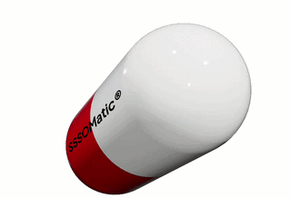

# SSSOmatic®
**Is your metadata suffering from semantic symptoms?**
Misalignment? Heterogeneity? Inconsistency?

**Try SSSOMatic®.**
*Discover matches. Assess relationships. Validate mappings.*

### For symptomatic metadata.

**Indications:**
- Heterogeneous terminology
- Misaligned standards
- Ambiguous mappings
- Manual mapping fatigue

> Each dose combines lexical and semantic scoring, LLM-based candidate assessment, and human validation.